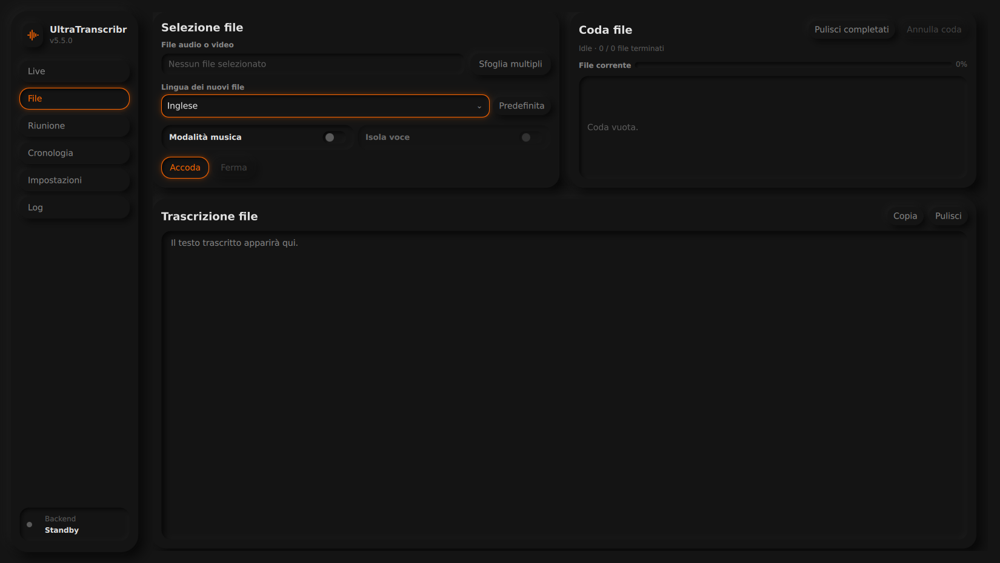

# Verifica della copia installata — 30 ottobre 2026

Collaudo delle 25 voci implementate della [roadmap](ROADMAP_UX_2026-10-29.md),
con aggiornamento richiesto del layout File. **SET-02, SET-03 e TEST-01 sono esclusi**
per decisione dell'utente. Il limite prestazionale di LIV-02 rimane esplicito.

## Ambiente e metodo

- Sorgenti e interprete della copia installata, aggiornata dalla PR #38; checkout
  precedente conservato in un ramo di backup. Dati e configurazione XDG di prova
  separati da quelli personali.
- Qt 6.12, KDE/Wayland, renderer **OpenGL reale**, acceleratore Intel rilevato senza
  simulazioni. Interazioni Qt con mouse, tastiera, selettori file e schermate
  controllate visivamente. Computer Use è stato interrogato, ma questa sessione
  esponeva soltanto browser e nessuna applicazione desktop; il fallback Qt è stato
  autorizzato esplicitamente dall'utente.
- La finestra QML e i servizi sono quelli installati. Il collaudo esclude
  l'integrazione nativa di dettatura e i permessi globali, appartenenti a TEST-01.
- I test automatici usano separatamente il renderer software/offscreen previsto
  dalla CI. **806 test passati in 61,69 s**; controlli statici Python, compilazione,
  sintassi installer/JavaScript e QML lint superati, senza warning/errori QML.
- Verificati gli hash di 30 file personali di configurazione e archivio: invariati.
  Audio e testi di collaudo, copie degli archivi e schermate contenenti dati personali
  restano locali; la schermata File pubblicata sotto non contiene tali dati.

## Correzioni emerse dal collaudo

1. **Arresto Live:** se il consumer usciva dall'attesa mentre veniva chiuso l'input,
   poteva dichiarare il buffer drenato pur contenendo un segmento non ancora emesso.
   Ora un arresto conserva sempre quel residuo. Il test riproduce il difetto prima
   della correzione e passa dopo; la prova nativa conserva **6,304875 s** in WAV.
2. **Apertura revisione:** la navigazione attende posizione e dimensioni effettive
   del layout prima di scorrere. La posizione iniziale provvisoria a zero non
   consuma più la richiesta di apertura.
3. **Scroll revisione:** trascinare le barre delle tre varianti sospende il follow
   audio; in precedenza il trascinamento non attivava sempre `movementStarted`.
4. **Clock dei video:** la conversione conserva silenzi iniziali e discontinuità
   temporali con `aresample=async=1:first_pts=0`, sia per File sia per Riunioni.
   Il file originale resta identico. Comportamento coerente con la
   [documentazione del ricampionatore FFmpeg](https://ffmpeg.org/ffmpeg-filters.html#aresample).
5. **Originale indisponibile:** un percorso spostato o non leggibile disabilita
   l'ascolto senza impedire l'apertura del testo di revisione. Nessun fallback
   al derivato e nessun accesso in lettura a percorsi esterni non ammessi.
6. **Recuperi in Cronologia:** precedenza al nome leggibile; percorso completo
   disponibile nel tooltip, invariato per le operazioni sul file.
7. **Menu:** la scelta evidenziata da tastiera viene portata in vista, anche nei
   menu lingua lunghi, e il valore interno resta il codice previsto.

Su richiesta dell'utente, **Selezione file e Coda file sono affiancati** nelle
finestre ampie; la trascrizione rimane sotto a tutta larghezza. Alla larghezza
minima i pannelli si dispongono in colonna. Le verifiche visive usano finestre
create a 1200×800, 1650×930 e 1920×1052, con dimensioni PNG corrispondenti.
Nell’ultima prova il compositor limita a 1052 px l’altezza utile richiesta di 1080 px.

## Matrice di verifica

| Voce | Riscontro |
| --- | --- |
| LIV-01 | Append/follow, selezione conservata e sospensione con input manuale nei test Qt; finestra Live nativa controllata. |
| LIV-02 | FIFO/RAM/disco e metriche testate; due catture native simultanee completate con `pending_audio_s=0` e spool vuoto. Arresto immediato con recovery verificato. Throughput: vedere limite sotto. |
| LIV-03 | Attese scheduler distinte dall'audio in coda; due sessioni native producono campioni di attesa non nulli mentre competono per il backend. |
| REV-01 | Originali byte-identici; cattura nativa a 48 kHz e derivato distinto a 16 kHz; player nativo apre l'MP4 originale. Casi mancanti/alterati/spostati testati. |
| REV-02 | 50 correzioni inserite con tastiera nella finestra installata e conservate dopo riavvio, insieme a nome e override speaker; bozza recuperata dopo SIGKILL al checkpoint. |
| REV-03 | Annulla/Ripristina nativi dopo autosave e dopo riavvio; errori, ordine delle scritture e conflitti dopo ricalcolo coperti dai test. |
| UI-01 | Live/File/Riunione: gerarchia confrontata sulle schermate reali. |
| UI-02 | Tooltip dispositivo mostrato con hover nativo; descrizioni tecniche disponibili senza righe permanenti. |
| UI-03 | Italiano selezionato → `it`, ripristino predefinita → `en`; navigazione da tastiera fino alla fine del menu verificata. |
| UI-04 | Tre dimensioni, layout e controlli verificati; scrollbar per contenuti eccedenti e scelta tastiera visibile. |
| LIV-04 | Pannello acquisizione compatto e trascrizioni indipendenti visibili nella finestra nativa. |
| LIV-05 | “Completa tutte” drena entrambe le sessioni; “Ferma tutte” conserva il residuo senza attendere una nuova trascrizione. |
| FIL-01 | Tre aree; selezione/coda affiancate, trascrizione sotto. |
| FIL-02 | Due WAV scelti dal selettore nativo, elaborati in ordine fino a 2/2 e 100%; stati intermedi e file corrente distinti. |
| MEET-01 | Avvio/termine acquisizione nativa e importazione video attraverso il selettore file, con pipeline effettiva Qwen/Community-1. |
| MEET-02 | Archivio a due colonne alla larghezza desktop e una al minimo. |
| MEET-03 | Apertura da card porta alla revisione; test di regressione e ripetizione nativa. |
| MEET-04 | Lista di nove interlocutori: raggiunto e controllato l'ultimo tramite barra nativa. |
| REV-04 | Dieci SVG presenti nella galleria; B1/B2/B3 esercitati con documento condiviso e schermate native. |
| REV-05 | Seek nativo, overlap `[0,1]`, play/pausa, focus conservato e sospensione/ripresa del follow. Video con offset verificato sotto. |
| HIST-01 | Nomi automatici delle sessioni native e dei recuperi leggibili; ID/percorso restano dati operativi. |
| HIST-02 | Ricerca e rinomina dalla Cronologia, confermate nel JSON persistente e dopo riapertura. |
| SET-01 | Large v3 nella configurazione ordinaria; migrazione delle impostazioni e protezione dei modelli precedenti nei test. Qwen rimane il motore Riunioni. |
| EXP-01 | TXT/SRT esportati dal dialogo nativo e contenenti tutte le 50 correzioni; nessun riferimento VTT nel runtime Python/QML/JS. |
| LOG-01 | Log del backend e dell'acquisizione presenti nella pagina nativa; lettura e comandi esistenti preservati. |

## Prove reali e loro limiti

- **Live:** due sessioni sul monitor di un'uscita virtuale dedicata, alimentata con
  parlato di prova; entrambe completate, testo presente e audio residuo zero.
  La seconda serie funzionale è stata svolta a batteria: i tempi non sono usati
  come confronto prestazionale con le prove precedenti a corrente.
- **Riunione nativa:** 12,3147 s acquisiti; originale FLAC mono **48 kHz**, copia
  di analisi **16 kHz**, SHA dell'originale verificata; Qwen e Community-1 producono
  una revisione completata. Non è una prova di nove persone fisiche.
- **Video:** MP4 con traccia audio che parte a 1,978667 s. Il precedente derivato
  durava 12,032 s e anticipava il segnale; quello corretto dura **14,0106875 s**,
  con primo segnale a **2,00575 s** e primo intervento a **2,02154 s**. Player
  nativo: durata 14.000 ms, seek dal timestamp, riproduzione e highlight verificati.
- **Archivio lungo:** copia di un documento da **2.389 interventi**, 12 cicli di
  salvataggio/riapertura, input invariati e nessun WebEngine caricato. Picco PSS
  osservato circa **249 MiB**. Il vecchio audio privo di originale è segnalato
  senza presentarlo come sorgente integra.
- **Persistenza:** 50 modifiche con accenti, rinomina speaker e override; chiusura e
  riapertura dell'intero processo. Separatamente, SIGKILL dopo journal confermato
  ma prima del salvataggio canonico: bozza recuperata. Resta la breve finestra
  precedente al checkpoint, già documentata nel rapporto iniziale.

**LIV-02 non certifica il tempo reale universale:** nel confronto precedente con
alimentazione controllata, 30 s di arretrato richiedevano 33,56 s anche dopo il
miglioramento. La conservazione dell'audio e la misura dell'arretrato sono verificate;
la velocità sotto qualunque carico non è dichiarata risolta.

Restano fuori da questa certificazione le registrazioni fisiche multi-sorgente
lunghe ore, nove voci reali, ascolti comparativi di qualità, contenitori con più
tracce audio selezionabili e lo sweep di accuratezza. SET-02/03 e TEST-01 sono
lasciati alla successiva valutazione dell'utente.
